  
  
  
  

## 🧭 About me

I build the front-ends money moves through: crypto exchanges, money transfer, e-wallets, digital-bank onboarding with e-KYC, and now Web3 / DeFi.
I lead a team of 6, build the Node.js APIs and databases behind the UI, and ship it all with Docker, CI/CD and Azure.

## 🛠️ The toolkit

<table>
<tr>
<td width="140"><b>Front-End</b></td>
<td>

</td>
</tr>
<tr>
<td><b>Back-End</b></td>
<td>

</td>
</tr>
<tr>
<td><b>Databases</b></td>
<td>

</td>
</tr>
<tr>
<td><b>DevOps & Cloud</b></td>
<td>

</td>
</tr>
<tr>
<td><b>Web3</b></td>
<td>

</td>
</tr>
<tr>
<td><b>Testing & AI</b></td>
<td>

</td>
</tr>
</table>

<b>🔐 Security · 💳 Payments · 🪪 KYC · ⚡ Optimisation · 👥 Leadership</b> (click to expand)

 

| Area | Tools & practices |
|---|---|
| 🔐 **Security** | ECC / AES-256 / RSA, HMAC-SHA512, nonce / replay protection, MITM protection, throttling & rate limits, CSP, RBAC, signed-message login, AWS KMS, audit remediation |
| 💳 **Payments & 3rd party** | Stripe, PayPal, Paystack, CCAvenue, PayU, Atom, Mollie, CoinGate, Banxa, Transak, ICICI / RBL IMPS, BitGo, Fireblocks, Safe, Binance / OKX APIs, TBO travel |
| 🪪 **KYC & identity** | Sumsub, Jumio, Trulioo, Aadhaar e-KYC, NID OCR, video liveness, KYC / KYB flows, Chainalysis, 2FA / OTP, transaction PIN, device registration |
| ⛓️ **Web3 & trading** | Smart-contract integration across 5+ dApps, EIP-712 / 1271 signatures, RainbowKit, WalletConnect, Multicall batching, DEX / intent API integration |
| ⚡ **Optimisation** | Webpack 4 / 5 splitChunks, tree-shaking & compression, code splitting, React.lazy, memoisation, virtualised tables, Redis caching, WebAssembly (Go / TinyGo) |
| 🧪 **Quality** | 80%+ coverage, fork / dry-run testing, code review, ESLint / Prettier |
| 👥 **Leadership** | Team lead (6 engineers), Agile / Scrum, hiring, mentoring, tech docs & handover, release management, L3 support |
| 📦 **Libraries implemented** | ECC encryption npm package, 35-control form engine, Jbs* React component kit, JSON menu & permissions, custom wagmi connector, Tailwind token system |

## 💼 14 years, four roles, one direction

<b>🟣 Front-End Team Lead</b> · Bankai Infotech (Bankai Group) · <i>2023 to present</i> · Web3, DeFi & trading

 

- Lead a **6-engineer front-end team** for Zeebu (telecom settlement & loyalty) and an intent-based DeFi protocol: architecture, sprint planning, code review, hiring, mentoring and **100+ production releases**.
- Moved Zeebu from **Web2 to Web3** in three steps: MetaMask + ethers.js → wagmi with a custom wallet connector → Reown AppKit.
- Integrated **money-market and protocol contracts**: supply / borrow / repay, ERC-4626 savings vaults, Safe multisig flows, Multicall batching and subgraph data.
- Built **intent-based settlement infrastructure** integrated with UniswapX, 1inch Fusion, CoW Protocol and OKX DEX, plus keeper and rebalancer bots, a treasury dashboard (980 commits) and a delta-neutral hedging engine.
- Ship every service myself: Docker → Azure Container Registry → GitHub Actions CI/CD with UAT → prod promotion → Azure Container Apps; Azure → AWS KMS federation for signing.
- Owned security: **OAK Security audit remediation**, encrypted payloads, nonce / replay and MITM protection, throttling, CSP, **20+ findings fixed**.

<b>🟢 Principal Consultant, Frontend</b> · Bankai Infotech (Bankai Group) · <i>Apr 2020 to 2022</i> · Digital banking & e-KYC

 

- Front-end lead for **MobiFin** banking and wallet portals for banks and telcos: NassWallet (Iraq), QCell / QMoney (Gambia), City Bank (Bangladesh), CRDB (Tanzania), 9PSB (Nigeria), Tangerine, ColtoMoney.
- Designed a **configuration-driven portal engine**: screens, forms and services render from JSON / CMS config per role, so new services ship without a redeploy.
- Built City Bank's **digital account opening**: huge rule-driven forms, NID card OCR, video liveness and a 6+ API fan-out.
- Implemented the in-house **ECC encryption npm package** (checksum + signature), replay / MITM protection, Go → WebAssembly crypto R&D, and tuned Webpack builds.

<b>🟣 PHP Developer → Principal Consultant, Front-End</b> · Joshi Biztech Solution · <i>Jan 2016 to Mar 2020</i> · Person of the Year 2018/19

 

- Grew from PHP developer to front-end lead across **15+ fintech products**: exchanges, DMT / IMPS money transfer, AEPS, recharge, white-label wallets, travel and marketplaces.
- Built crypto exchanges on CodeIgniter + MySQL (Ohocash, Paro), then rebuilt Paro in **React + Redux-Saga** on a .NET API, which became a **white-label exchange for 8+ brands**.
- Built a secure Node.js CAB API on MSSQL, AES + RSA encrypted money transfer, and an OpenCart ↔ Node.js flight module with caching.
- Integrated **15+ payment gateways**, ICICI / RBL bank APIs, BitGo wallets and Aadhaar e-KYC; mentored 8 to 12 engineers.
- Company acquired by Bankai Group in Mar 2020.

<b>🔵 PHP Developer</b> · Cantech · <i>Oct 2012 to Dec 2015</i> · E-commerce, SaaS & enterprise web

 

- Built e-commerce stores, SaaS modules and enterprise web apps in PHP (CodeIgniter, OpenCart), MySQL and jQuery.
- Mailchimp, Zoho and Facebook Account-Kit integrations; reusable form / table / dashboard kits.

## 🚀 Featured builds

> Most of this work lives in private company repos. Full case studies and visuals are on **[the portfolio](https://devang-parekh.vercel.app)**.

<b>⛓️ Zeebu dApp: Web2 → Web3 staking & referral</b> · <i>2023 to 2025</i>

 

`Next.js 14` `TypeScript` `ethers` `wagmi v2` `Reown AppKit` `Sumsub` `Apollo`

- Converted a live Web2 product to Web3 in three steps: MetaMask + ethers.js → wagmi v2 with a custom wallet connector, chain switching and session persistence → Reown AppKit.
- Staking for ZBU, LP, vZBU and vLP across chains: stake, withdraw, early withdraw, restake, bonus and points → token claim.
- Waitlist + referral system: invite codes, referral commission, leaderboard, social tasks, airdrop and Chainalysis screening.
- Wallet-signature registration; KYC / KYB via Sumsub; encrypted payloads, replay protection and OAK Security audit fixes.

<b>🔁 Intent-based settlement: UniswapX, 1inch Fusion, CoW & OKX</b> · <i>2026</i>

 

`TypeScript` `Node.js` `ethers v6` `PostgreSQL` `AWS KMS` `Docker` `Azure Container Apps` `Claude Code`

- Intent execution service (335 commits): inventory-backed settlement of UniswapX and 1inch Fusion intent orders, with pre-trade simulation, multi-venue quoting, post-fill hedging and MEV-aware submit lanes.
- Risk controls: fleet-wide open-volume cap, volatility gate, fleet-wide quote pause, per-pair markup and buy / sell switches from a live config console.
- OKX DEX intent settlement: /quote → /solve → /settle with EIP-712 signing and KMS broadcast; Multicall batching cut RPC load **~138k → ~49k calls / day**.
- CoW Protocol intent settlement with a dry-run master switch and JIT ERC-1271 settlement.
- Per-venue dry-run and UAT / pre-prod / prod pipelines via GitHub Actions.

<b>🛡️ Delta-neutral hedging engine: perps & dated futures</b> · <i>2026 · AI-built</i>

 

`Claude Code` `PostgreSQL` `Redis` `OKX v5 API`

- Built end to end with Claude Code: I wrote the spec, risk rules and test plan, the AI wrote the code, and I reviewed and tested every change. 11 crates, **1,900+ tests**.
- OCO brackets, trailing stops, reprice ladder, long / short netting, exposure caps per asset / side / route, and a kill switch.
- HMAC-signed API with replay protection, PnL attribution, Telegram alerts and an operator console.

<b>📊 Multi-chain treasury & trading-ops dashboard</b> · <i>2026</i>

 

`Next.js 14` `tRPC v11` `Drizzle` `PostgreSQL` `Redis` `Safe SDK` `AWS KMS` `Docker`

- Lead author (**980 commits**): 3-of-5 Safe multisig across 5 EVM chains with propose → sign → execute flows, delegates, whitelisting and signed-message login.
- Treasury, money-market, settlement, market-maker, hot-wallet and CEX views: PnL, solvency, reconciliation, rebalancing and alerts.
- 3-tier data fallback keeps pages up when a source fails; virtualised tables with CSV / XLSX export.

<b>🏦 Money market & DeFi savings dApp</b> · <i>2024 to 2026</i>

 

`Next.js 13–16` `React 19` `wagmi` `viem` `Safe Apps SDK` `MUI` `Jest` `Cypress`

- Aave-style money market: supply / borrow / repay / withdraw, health factor, reserve analytics; swap & bridge via KyberSwap, Paraswap and Wormhole; Transak on-ramp.
- Savings, swap, portfolio and proof-of-reserves pages; ERC-4626 vaults; runs as a Safe App with EIP-1271 signature checks.
- Multicall batching, subgraph charts (TVL / APY), **80%+ Jest coverage** and Cypress E2E.

<b>🪪 City Bank: digital account opening & e-KYC</b> · <i>2020 to 2022</i>

 

`React` `Redux-Saga` `JSON-config engine` `ECC + AES` `Go WASM` `Webpack`

- Self, loan, merchant and credit-card onboarding across agent, branch and sales channels, with very large rule-driven forms.
- NID card OCR, identity validation and video liveness; one submit fans out to 6+ bank APIs.
- Every request ECC + AES encrypted with checksum and signature, plus replay and MITM protection.

<b>👛 NassWallet: plug-and-play wallet platform</b> · <i>2020 to 2022</i>

 

`React` `Redux-Saga` `Material-UI` `Highcharts` `PWA` `Node.js`

- Dynamic service engine: onboarding, KYC and every transaction render from server-side config, with 35 reusable form controls and per-role actions.
- **35+ services live in Iraq**: P2P, cash-in / cash-out, bill pay, airtime, e-vouchers, bulk disbursement, 3-D Secure top-up.
- English / Arabic / Kurdish with RTL, maker-checker approvals, 2FA, transaction PIN and QR pay. The same engine powers 5 more banks and telcos.

<b>📈 Paro Exchange: PHP → React + .NET rebuild</b> · <i>2018 to 2020</i>

 

`React` `Redux-Saga` `.NET API` `SignalR` `WebSocket` `TradingView`

- Rebuilt a CodeIgniter exchange as a React + Redux-Saga trading UI with a live order book, trades and ticker over SignalR / WebSocket.
- Built the Jbs* component library; the product became a **white-label exchange used by 8+ brands**.
- Spot trading with limit / stop orders, deposits, withdrawals, 2FA, KYC, referrals and admin panels.

<b>📂 More builds</b>: payments, money transfer, travel, wallets

 

| Build | What | Stack |
|---|---|---|
| Zeebu PSP & Backoffice | Invoices, swap-and-pay, settlement hooks, Fireblocks auto-withdrawal, BSC → Base | Next.js, TypeScript, Fireblocks, wagmi |
| Money Transfer (DMT / IMPS) | IMPS / NEFT via ICICI, RBL, AU bank APIs; AES + RSA on every call | OpenCart, AngularJS, Node.js |
| Rupio Wallet | Recharge, DMT, AEPS, travel, Aadhaar e-KYC, commission rules | OpenCart, JavaScript, MySQL |
| Ohocash Exchange | Multi-pair trading, order matching, wallet ledger | CodeIgniter, MySQL, WebSocket |
| BFIC / XChangeOn | Trading wallet, KYC, IPO-style token sale, Stripe / PayPal | React, .NET API |
| CAB API | Secure REST API with JWT and a third-party adapter | Node.js, Express, MSSQL |
| Flight & Travel | TBO supplier search with result caching | OpenCart, Node.js, MySQL |
| ECC & Form Engine | ECC + AES npm package and a 35-control form engine | TypeScript, React, npm |

## 🤖 How I ship with AI

Every feature starts as a **written spec**, becomes a **step-by-step plan**, and is implemented by **Claude Code agents** in parallel git worktrees.
I treat the model as a fast junior: I own the design, review every change and test before release.

  <b>Let's build something that moves money.</b>  
  
  
  

